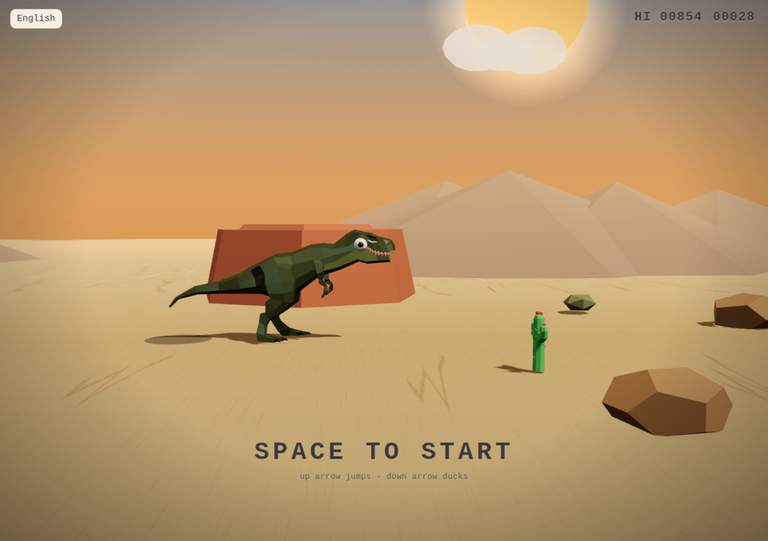

# 3D Chrome Dino AI Slop

Chrome Dino, 3D AI slop version. Exactly that.



```bash
npm install
npm run dev
```

On the first launch, choose your dinosaur. The choice is saved in this browser.

The code for this game is under the MIT license. See [LICENSE](LICENSE). The models in `public/models/` are excluded and follow the licenses below.

## Credits

- T-Rex, Velociraptor, Triceratops, Stegosaurus, Parasaurolophus, and Apatosaurus by [Quaternius](https://poly.pizza/u/Quaternius), public domain (CC0). [T-Rex](https://poly.pizza/m/UYtneO5FpF) · [package credits](https://poly.pizza/l/C2VKevq7xR/credits)
- Cactus by Quaternius, CC0. [poly.pizza/m/HsEJgRLQWX](https://poly.pizza/m/HsEJgRLQWX)
- Cactus Flowers by Quaternius, CC0
- Cactus (saguaro) by Poly by Google, CC-BY 3.0. [poly.pizza/m/1_3Ur2-LAs8](https://poly.pizza/m/1_3Ur2-LAs8)
- Barrel cactus by Poly by Google, CC-BY 3.0. [poly.pizza/m/5-hrumGDq1K](https://poly.pizza/m/5-hrumGDq1K)
- Cactus by jeremy, CC-BY 3.0. [poly.pizza/m/fr1vXosiRgr](https://poly.pizza/m/fr1vXosiRgr)
- Pterosaur (Pterablocktyls) by [Hoai Nguyen](https://poly.pizza/u/Hoai%20Nguyen), CC-BY. [poly.pizza/m/1tuiNTr4-MX](https://poly.pizza/m/1tuiNTr4-MX)
